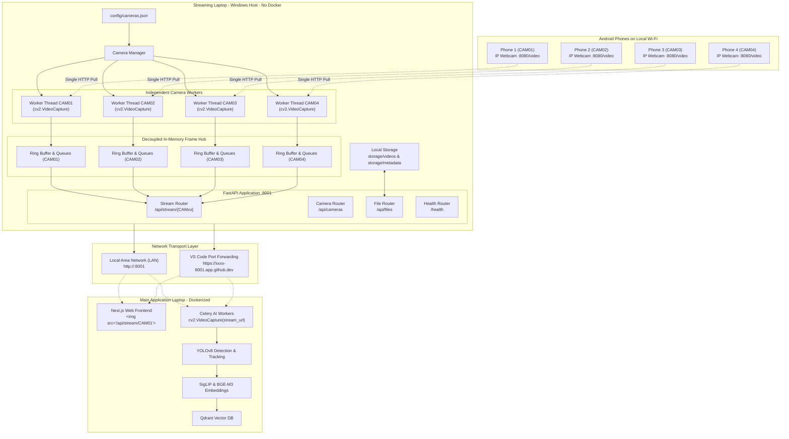

# Multi-Camera Video Gateway — Complete Architecture & Operations Manual

---

## 1. Executive Summary & Purpose

The **Standalone Video Gateway** is an ingestion, multiplexing, and relay service designed to run on the **Streaming Laptop** (Windows host OS) **without Docker**.

### The Problem It Solves
1. **Hardware & Resource Decoupling:** AI and Computer Vision workloads (YOLO, SigLIP embeddings, Qdrant vector database, Qwen LLM) require heavy GPU/CPU resources and run inside Docker on a separate **Main Application Laptop**. The Streaming Laptop only needs to handle video ingestion, stream multiplexing, and storage relay without any AI overhead.
2. **Phone Resource Limitations:** Android phones running the **IP Webcam** app have constrained processors and thermal limits. If multiple consumers (e.g., Next.js frontend, Celery detection worker, recording worker) connect directly to a phone's stream, the phone overheats, drops Wi-Fi packets, and crashes. The gateway connects to each phone **exactly once**, buffers frames in memory, and fans them out to unlimited subscribers with zero latency.
3. **Network & Fault Isolation:** If one phone's Wi-Fi drops (e.g., CAM02), the other 3 cameras must continue streaming smoothly without interrupting the main application. The gateway manages independent reconnection workers with exponential backoff for each camera.
4. **Protocol Standardization:** The gateway converts varied phone endpoints into clean, universally supported HTTP **MJPEG streams** (`multipart/x-mixed-replace`) with absolute ISO-8601 UTC timestamps embedded in frame headers.
5. **Direct Network Access:** All stream and metadata endpoints are openly accessible on port 8001 without requiring API keys or authentication headers.

---

## 2. End-to-End System Architecture



---

## 3. Core Working Mechanisms

### 3.1 Independent Camera Capture Loops
Each camera defined in `config/cameras.json` is encapsulated in a `CameraStream` object and assigned a dedicated background daemon thread:
* **Connection:** Uses OpenCV with FFmpeg backend (`cv2.VideoCapture(source_url, cv2.CAP_FFMPEG)`).
* **Buffer Management:** `cv2.CAP_PROP_BUFFERSIZE` is set to `1` so OpenCV never buffers stale frames.
* **FPS & Resolution Probing:** Dynamically calculates incoming FPS every 2 seconds and extracts pixel resolution (e.g. `1920x1080`).
* **Frame Serialization:** Incoming NumPy BGR frames are encoded into compressed JPEG byte buffers (`cv2.imencode(".jpg", frame, [cv2.IMWRITE_JPEG_QUALITY, 80])`).

### 3.2 Thread-Safe Asynchronous Frame Multiplexing
```
[Capture Worker Thread]
       │ (imencode)
       ▼
 [JPEG Bytes + UTC Timestamp]
       │
       ▼
 ┌────────────────────────────────────────────────────────┐
 │ _dispatch_to_subscribers()                             │
 │ Iterates over active subscriber asyncio.Queue objects: │
 │   - If queue is full: drop oldest frame (zero latency) │
 │   - Post newest frame via loop.call_soon_threadsafe()  │
 └──────┬──────────────────────┬──────────────────────────┘
        │                      │
        ▼                      ▼
  [Client 1: Browser UI]  [Client 2: AI Worker]
```
* **Decoupled Subscribers:** When a client opens `/api/stream/CAM01`, an `asyncio.Queue(maxsize=2)` is registered.
* **Zero Latency Guarantee:** If a slow subscriber is slightly behind, the queue drops the older frame and immediately provides the freshest frame.

### 3.3 Dynamic Fallback Status Slate
If a camera is not yet configured, connecting, reconnecting, or encounters an error, the streaming endpoint does **not** close or return a broken pipe.
* The gateway's `make_status_frame()` generates an on-the-fly 640x360 status image with a dark slate theme, colored status indicator (green for ONLINE, orange for RECONNECTING, red for ERROR), current UTC clock, and camera name.
* When the phone connects or recovers, the stream smoothly transitions from the status slate to live camera footage without requiring the client to refresh.

### 3.4 Live Streaming Protocol (MJPEG Multipart)
Continuous video is **never** sent as JSON or base64.
* It uses the standard HTTP multipart response:
  ```http
  HTTP/1.1 200 OK
  Content-Type: multipart/x-mixed-replace; boundary=frame
  Cache-Control: no-cache, no-store, must-revalidate

  --frame
  Content-Type: image/jpeg
  Content-Length: 52314
  X-Timestamp: 2026-10-08T17:04:33.626733+00:00

  <raw jpeg bytes>
  --frame
  Content-Type: image/jpeg
  Content-Length: 52402
  X-Timestamp: 2026-10-08T17:04:33.726712+00:00

  <raw jpeg bytes>
  ```
* **Native Browser Display:** Any modern web browser renders this stream directly inside a standard HTML `` tag without any JavaScript player, authentication tokens, or WebRTC signaling.
* **OpenCV Compatibility:** OpenCV on the Main Application reads it natively via `cv2.VideoCapture("http://<GATEWAY-IP>:8001/api/stream/CAM01")`.

### 3.5 Fault Tolerance & Reconnection Matrix

| Scenario | Worker Behavior | Other Cameras | Gateway Server |
| :--- | :--- | :--- | :--- |
| **Phone disconnected from Wi-Fi** | Enters `RECONNECTING`. Exponential backoff (1s -> 2s -> 4s -> max 10s). | Continue streaming normally with zero frame drops. | Remains `ONLINE`. |
| **Phone Wi-Fi restored** | Detects socket connection, resets reconnect counter, transitions to `ONLINE`. | Unaffected. | Remains `ONLINE`. |
| **All phones disconnected** | All 4 workers enter `RECONNECTING`. | All retry independently. | Remains `ONLINE` on port 8001. |
| **Empty `source_url: ""`** | Marked `NOT_CONFIGURED`. Worker does not start. | Other cameras run normally. | Starts cleanly without errors. |
| **Invalid/Wrong URL** | Catches socket exception, logs error, enters `RECONNECTING`. | Unaffected. | Remains `ONLINE`. |

### 3.6 RAM-Safe Chunked Video Storage
* **Upload (`POST /api/files/upload`):** Video streams directly from the HTTP request to disk in **64 KB chunks**. Files are never buffered in system RAM.
* **Checksumming:** SHA-256 hash is computed in real time during streaming.
* **Metadata Extraction:** Probes codec, frame rate, and duration using `ffprobe` (with OpenCV fallback).
* **Download (`GET /api/files/{file_id}/download`):** Returns FastAPI `FileResponse` with HTTP `Range` header support for seeking and scrubbing in media players.
* **Path Traversal Protection:** Validates strict UUID regex for all `file_id` parameters and resolves canonical paths against the storage root directory.

---

## 4. Codebase Structure & Component Breakdown

```
video-gateway/
├── app/
│   ├── __init__.py           # Package versioning (v1.0.0)
│   ├── main.py               # Application bootstrap, lifespan events, CORS, router inclusion
│   ├── config.py             # Pydantic Settings (.env management, directory creation)
│   ├── models.py             # Pydantic schemas, CameraStatus enum, metadata models
│   ├── api/
│   │   ├── health.py         # GET /health, GET /api/info
│   │   ├── cameras.py        # GET /api/cameras, POST start/stop/restart
│   │   ├── streams.py        # GET /api/streams, GET /api/stream/{camera_id} (MJPEG)
│   │   └── files.py          # POST /upload, GET /files, GET /download
│   └── services/
│       ├── camera_manager.py # Camera lifecycle orchestration & config file handling
│       ├── stream_manager.py # CameraStream worker thread, frame ring buffer, subscribers
│       ├── file_manager.py   # Chunked disk streaming, ffprobe inspection, SHA-256
│       └── health_manager.py # System checks (FFmpeg/FFprobe PATH check, uptime)
├── config/
│   ├── cameras.example.json  # Configuration template
│   └── cameras.json          # Active camera URLs (gitignored)
├── storage/
│   ├── videos/               # Saved video files (.mp4, .mkv)
│   └── metadata/             # Saved JSON metadata records
├── tests/
│   ├── test_health.py        # Health probe tests
│   ├── test_auth.py          # Public access tests (verifies no auth required)
│   ├── test_cameras.py       # Camera listing and control tests
│   ├── test_streams.py       # MJPEG stream endpoint tests
│   └── test_files.py         # Upload, download, and path traversal tests
├── .env.example              # Environment variables template
├── .gitignore                # Git exclusions
├── requirements.txt          # Python dependencies
└── README.md                 # Project documentation
```

---

## 5. Step-by-Step Practical Operations Guide

### Step 1: Install Prerequisites (Windows Streaming Laptop)
1. **Python 3.10+**: Ensure Python is installed and added to PATH (`python --version`).
2. **FFmpeg on System PATH**:
   * Open PowerShell as Administrator and run:
     ```powershell
     winget install Gyan.FFmpeg
     ```
   * Or download manually from [gyan.dev/ffmpeg/builds](https://www.gyan.dev/ffmpeg/builds/), extract to `C:\ffmpeg`, and add `C:\ffmpeg\bin` to Windows System Environment Variables `PATH`.
   * Verify in a new PowerShell window:
     ```powershell
     ffmpeg -version
     ffprobe -version
     ```

### Step 2: Set Up Virtual Environment & Dependencies
```powershell
cd "d:\1.KPR\2nd year\git projects\camera streaming\video-gateway"

# Create virtual environment
python -m venv .venv

# Activate virtual environment
.\.venv\Scripts\Activate.ps1

# Install dependencies
pip install -r requirements.txt
```

### Step 3: Configure Environment Variables (`.env`)
```powershell
Copy-Item .env.example .env
```
Edit `.env` to configure your port and host:
```env
GATEWAY_HOST=0.0.0.0
GATEWAY_PORT=8001
CAMERA_CONFIG_PATH=config/cameras.json
STORAGE_PATH=storage
REQUIRE_FFMPEG=true
LOG_LEVEL=INFO
```

### Step 4: Configure Android Phone IP Webcam Streams
1. Install **IP Webcam** by Pavel Khlebovich on your Android phones.
2. Connect the phones and the Streaming Laptop to the same Wi-Fi network.
3. Open the app on each phone, scroll to the bottom, and tap **Start server**.
4. The phone displays an address (e.g. `http://10.8.3.155:8080`).
5. Open `config/cameras.json` and enter the complete stream URLs:

```json
{
  "cameras": [
    {
      "camera_id": "CAM01",
      "name": "Entrance Camera",
      "source_url": "http://10.8.3.155:8080/video",
      "enabled": true
    },
    {
      "camera_id": "CAM02",
      "name": "Corridor Camera",
      "source_url": "http://10.8.3.156:8080/video",
      "enabled": true
    },
    {
      "camera_id": "CAM03",
      "name": "Lobby Camera",
      "source_url": "http://10.8.3.157:8080/video",
      "enabled": true
    },
    {
      "camera_id": "CAM04",
      "name": "Exit Camera",
      "source_url": "http://10.8.3.158:8080/video",
      "enabled": true
    }
  ]
}
```

> **Critical Note on Stream URL:**
> Always use the complete stream endpoint ending with `/video` (e.g. `http://10.8.3.155:8080/video`). If you enter just the root URL `http://10.8.3.155:8080/`, it serves the IP Webcam web management UI rather than the raw video feed.

### Step 5: Start the Gateway
```powershell
python -m app.main
```
The server binds to `0.0.0.0:8001`.

---

## 6. Accessing & Viewing Streams

### 6.1 In Web Browsers
Open any browser tab directly (no query parameters or tokens required):
* **CAM01:** `http://localhost:8001/api/stream/CAM01`
* **CAM02:** `http://localhost:8001/api/stream/CAM02`
* **CAM03:** `http://localhost:8001/api/stream/CAM03`
* **CAM04:** `http://localhost:8001/api/stream/CAM04`

From another laptop on the same Wi-Fi network:
* `http://<STREAMING-LAPTOP-IP>:8001/api/stream/CAM01`

### 6.2 Interactive Swagger API Documentation
Open:
[http://localhost:8001/docs](http://localhost:8001/docs)
Execute any endpoint directly from the browser without authorization prompts.

### 6.3 Checking Status via PowerShell
```powershell
# Public health probe
Invoke-RestMethod -Uri "http://localhost:8001/health"

# Detailed camera list
Invoke-RestMethod -Uri "http://localhost:8001/api/cameras"
```

---

## 7. Connecting Main Application Laptop to the Gateway

### Scenario A: Same Local Wi-Fi Network
1. Find the Streaming Laptop's local IP address:
   ```powershell
   Get-NetIPAddress -AddressFamily IPv4 | Where-Object { $_.InterfaceAlias -like "*Wi-Fi*" }
   ```
   (Suppose it is `10.8.3.200`).
2. On the **Main Application Laptop**, set in its `.env`:
   ```env
   GATEWAY_URL=http://10.8.3.200:8001
   ```

### Scenario B: Different Networks (VS Code Port Forwarding)
1. In VS Code on the Streaming Laptop, click the **Ports** tab in the bottom panel.
2. Click **Forward a Port** and enter `8001`.
3. Right-click the forwarded port -> **Port Visibility** -> **Public**.
4. Copy the generated **Forwarded Address** (e.g. `https://abc123-8001.app.github.dev`).
5. In the Main Application Laptop's `.env`, set:
   ```env
   GATEWAY_URL=https://abc123-8001.app.github.dev
   ```

### Consuming in Main Application Code

#### 1. Next.js Frontend (`frontend/src/app/...`)
```tsx
export default function CameraFeed({ cameraId }: { cameraId: string }) {
  const streamUrl = `${process.env.NEXT_PUBLIC_GATEWAY_URL}/api/stream/${cameraId}`;
  
  return (
    <div className="rounded-xl overflow-hidden border border-zinc-800 bg-black">
      
    </div>
  );
}
```

#### 2. Python / Celery AI Workers (`backend/app/workers/...`)
```python
import cv2

stream_url = f"{settings.GATEWAY_URL}/api/stream/CAM01"
cap = cv2.VideoCapture(stream_url)

while True:
    ret, frame = cap.read()
    if not ret:
        break

    # Pass frame to YOLO object detection & SigLIP embeddings
    detections = yolo_model(frame)
```

---

## 8. REST API Reference

| HTTP Method | Route | Description | Auth Required |
| :--- | :--- | :--- | :--- |
| `GET` | `/health` | Public liveness probe & system overview | No |
| `GET` | `/api/info` | Gateway metrics, camera counts, FFmpeg status | No |
| `GET` | `/api/cameras` | List metadata and real-time state of all 4 cameras | No |
| `GET` | `/api/cameras/{id}` | Detailed status for a single camera | No |
| `POST` | `/api/cameras/{id}/start` | Start/enable ingestion for a camera | No |
| `POST` | `/api/cameras/{id}/stop` | Stop ingestion worker for a camera | No |
| `POST` | `/api/cameras/{id}/restart`| Trigger reconnection cycle for a camera | No |
| `GET` | `/api/streams` | List live stream metadata for all cameras | No |
| `GET` | `/api/streams/{id}` | Stream metadata for a single camera | No |
| `GET` | `/api/stream/{id}` | **Live MJPEG video stream** (`multipart/x-mixed-replace`) | No |
| `GET` | `/api/files` | List recorded video files (optional filter `?camera_id=`) | No |
| `GET` | `/api/files/{id}` | Fetch metadata for a specific recorded video file | No |
| `GET` | `/api/files/{id}/download` | Stream download recorded video with Range support | No |
| `POST` | `/api/files/upload` | Upload video file with metadata (chunked streaming) | No |

---

## 9. Verification & Automated Test Suite

To run all automated unit and integration tests:
```powershell
pytest -v
```

All 18 automated test suites validate:
* Complete public access across all endpoints without authentication.
* Proper detection and fallback for unconfigured cameras.
* Camera controls (`start`, `stop`, `restart`).
* Live stream multipart header compliance (`boundary=frame`, `X-Timestamp`, JPEG image content).
* Chunked file upload, disk storage, SHA-256 validation, and chunked download.
* Path traversal attack prevention.

---

## 10. Operational Troubleshooting FAQ

### Q1: CAM01 shows `RECONNECTING` or `Unable to open stream`.
* **Cause:** The URL was configured without `/video` (e.g. `http://10.8.3.155:8080/`), or the phone's IP address changed.
* **Fix:** Open IP Webcam on the phone, confirm the IP shown on screen, and update `config/cameras.json` to include `/video`:
  ```json
  "source_url": "http://10.8.3.155:8080/video"
  ```

### Q2: Phone video feed stutters or drops frames.
* **Cause:** 1080p resolution over saturated Wi-Fi.
* **Fix:** In the IP Webcam app settings on Android, go to **Video preferences** -> set resolution to **1280x720** (720p) and quality to **50%**. This reduces bandwidth consumption from ~15 Mbps to ~4 Mbps per camera while preserving clear detection quality.

### Q3: Does the gateway write continuous video to disk automatically?
* No. Continuous 24/7 recording to disk without retention policies will fill up disk space quickly. The gateway provides high-speed live streams and a dedicated chunked file API (`/api/files/upload` and `/api/files/{id}/download`). The Main Application or a scheduled job uploads/records incident clips as needed.
